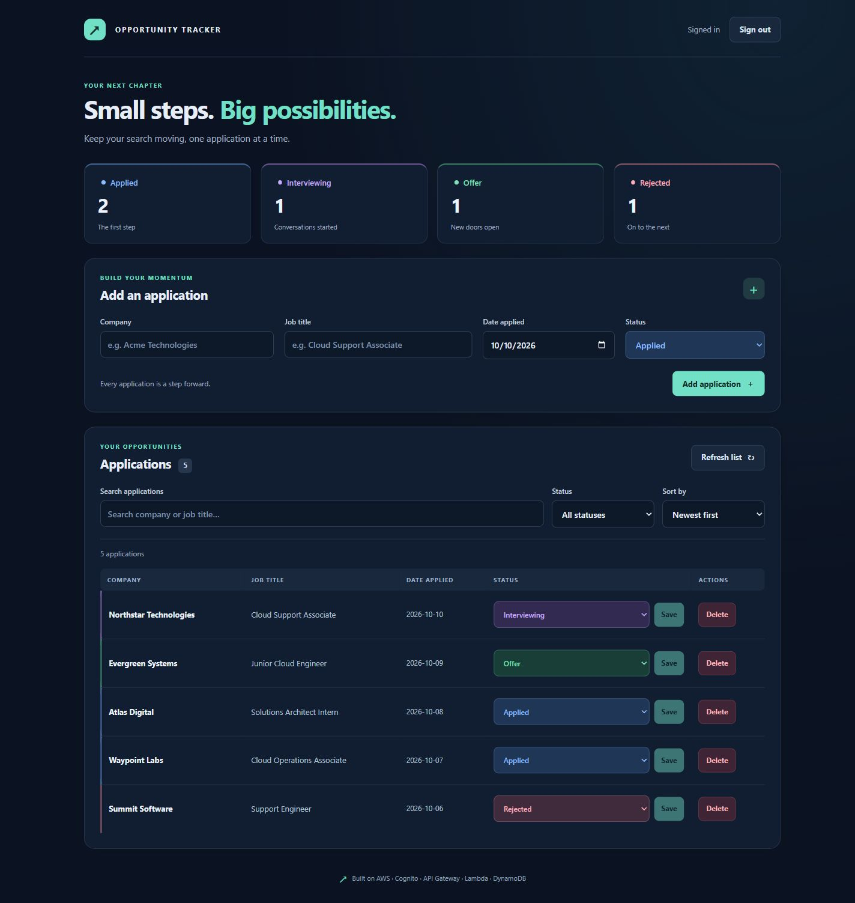
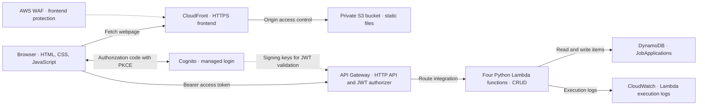

# Serverless Job Application Tracker

[](https://github.com/rogerrosenquist/aws-job-application-tracker/actions/workflows/checks.yml)

A personal job application tracker deployed on AWS. A static JavaScript frontend signs in through Amazon Cognito and calls a protected HTTP API to create, list, update, and delete applications in DynamoDB.

Built as a practical project while studying for AWS Solutions Architect Associate. The first version was provisioned through the AWS console and verified against the deployed services.

**[Open the hosted app](https://d3vx7zv7kgrlly.cloudfront.net/)** — the welcome page is public; dashboard access requires an invited Cognito account. Public self-registration is disabled.

## Dashboard preview



The current frontend rendered locally with fictional sample data for a dashboard preview. Visitors can view it without a Cognito account. The [original deployed screenshot](docs/images/dashboard.png) records the first version.

## Features

- Add a company, job title, application date, and status.
- Search by company or job title and filter by status.
- Sort applications by newest, oldest, or company name.
- See clickable status totals with blue Applied, purple Interviewing, green Offer, and rose Rejected accents.
- Change status to Applied, Interviewing, Rejected, or Offer.
- Delete an application after confirmation.
- Sign in and sign out with Cognito-managed login.
- Use the hosted app with the local development server stopped.
- Use a table on desktop and application cards on smaller screens.

## Architecture



CloudFront serves the webpage files. Browser API requests go directly to API Gateway, so the distribution's WAF applies to the static frontend path. API Gateway validates the JWT before invoking the route's Lambda function.

Read the [architecture decisions](docs/architecture.md) and [deployment guide](docs/deployment.md).

## API

All four routes use the Cognito JWT authorizer.

| Method | Route | Lambda | DynamoDB permission |
|---|---|---|---|
| GET | `/applications` | `ListJobApplications` | `Scan` |
| POST | `/applications` | `CreateJobApplication` | `PutItem` |
| PATCH | `/applications/{applicationId}` | `UpdateApplicationStatus` | `UpdateItem` |
| DELETE | `/applications/{applicationId}` | `DeleteJobApplication` | `DeleteItem` |

Example application:

```json
{
  "applicationId": "generated-uuid",
  "company": "Example Company",
  "jobTitle": "Cloud Support Associate",
  "dateApplied": "2026-10-10",
  "status": "Applied"
}
```

The partition key is `applicationId` (String). Create requires the other four fields and generates the ID. PATCH changes status only. Invalid input returns 400; updating/deleting a nonexistent item returns 404. Creating returns 201; listing, updating, and deleting return 200. Listing follows DynamoDB scan pagination.

## Security and scope

- Cognito uses a public SPA client without a client secret, authorization code with PKCE, and a random state checked on callback.
- Access tokens stay in browser memory and travel in the Authorization header. Reloading requires signing in again.
- Each Lambda role has one DynamoDB action scoped to the table, plus basic logging permissions.
- S3 public access stays blocked; CloudFront reads files through origin access control.
- API CORS allows the configured local and hosted origins; JWT validation enforces authentication.

**This is a single-owner application.** Authorized pool users share the same records. There is no per-user isolation or public demo account. Route authorization scopes are empty in this version: the browser submits an access token, but scopes do not constrain the authorizer to access-token-only acceptance. See [planned improvements](docs/architecture.md#planned-improvements).

The API URL, Cognito domain/client ID, and hosting address in `app.js` are public configuration values. Passwords, AWS credentials, and session tokens are not part of the repository.

## Run locally

From the project folder with Python installed:

```powershell
py -m http.server 8000 --bind 127.0.0.1 --directory .
```

Open **http://localhost:8000/** and keep the terminal running. On macOS/Linux use `python3` instead of `py`. This serves the frontend and calls the configured AWS backend. For your own deployment, change the public configuration in `app.js` and register the matching Cognito callback/sign-out URLs and API CORS origins.

## Tests

With Python 3.14 and Node.js installed, run from the project folder:

```powershell
py -m unittest discover -s tests -v
node --check app.js
node --test tests/ui.test.cjs
```

Offline tests use SDK/DynamoDB and DOM/fetch doubles. They cover handler behavior, pagination, invalid input, missing records, PKCE/state checks, filtering, sorting, status totals, status saves, deletion confirmation, error recovery, and API 401 handling. They also verify that a late response cannot redraw signed-out records. They do not create AWS resources or prove the deployed IAM configuration.

The included GitHub Actions workflow runs the checks on pushes and pull requests; it does not deploy to AWS. The [first published run](https://github.com/rogerrosenquist/aws-job-application-tracker/actions/runs/38092366213) passed the JavaScript syntax check, 16 Python tests, and 8 JavaScript tests.

Hosted sign-in, CRUD persistence, and sign-out were also verified manually against DynamoDB. See the [validation record](docs/validation.md).

## Repository layout

```text
index.html / styles.css / app.js   Frontend files uploaded to S3
backend/                          Four Lambda source folders
examples/                         Lambda events with fictional data
tests/                            Offline Python and JavaScript tests
docs/                             Architecture, deployment, validation, showcase copy
.github/workflows/checks.yml       Automated checks
```

## Costs and next steps

The deployment uses DynamoDB on-demand and the CloudFront Free plan. The account has budget email alerts. Actual costs depend on usage and applicable service pricing; budgets are alerts rather than spending caps.

Next improvements are infrastructure as code, per-user ownership before adding users, API scopes, and error/latency alarms. This repository documents the console deployment and does not yet automate infrastructure creation.
